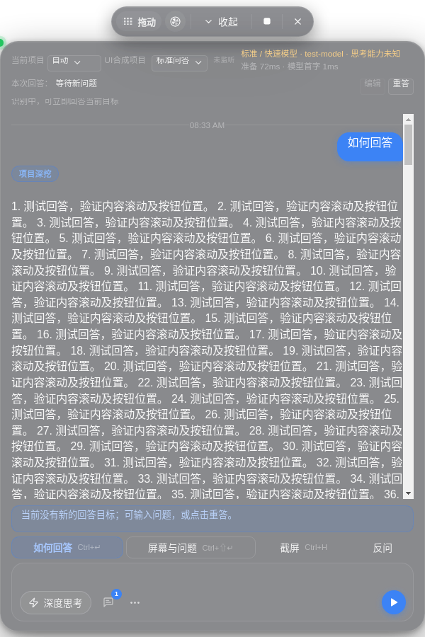
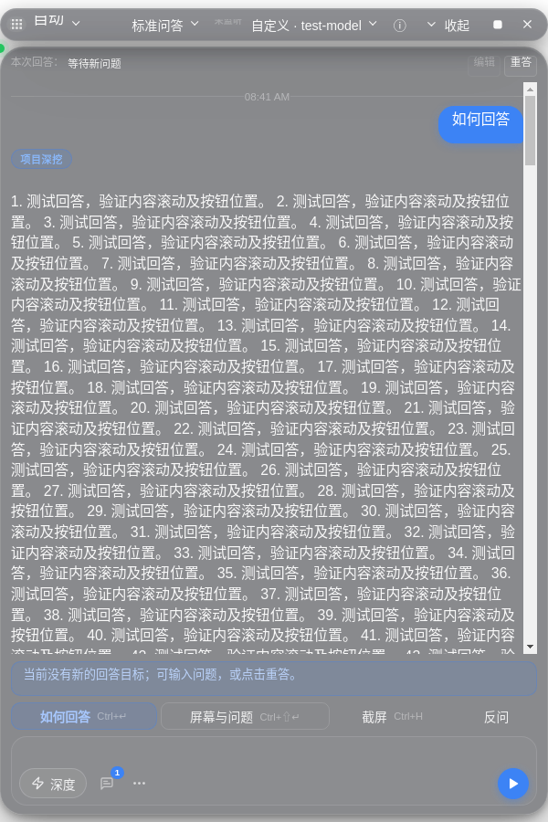

# CUE 项目速答与模型配置优化

本次以 cue `41f70c2`、Arclight `528704e`、CAE `c50dd29` 为审查基线。没有把历史“首字 11–23 秒”认作已经证实的 RAG 问题。当前机器没有两套模型密钥，在线延迟未验收，也不承诺 1 秒首字。

## 使用与请求行为

设置 → 模型中保留原自定义/Qwen 密钥、地址和快速/深度型号，另增加独立 DeepSeek 密钥、地址、快速/深度型号。默认 `https://api.deepseek.com`、`deepseek-flash`，输入框可编辑。切换生成服务不修改 ASR 供应商；自动 Qwen ASR 继续从自定义/Qwen 的原配置读取凭据。

极速的思考偏好独立于标准偏好。官方 DashScope 的 `qwen3.8-flash` 发送顶层 `enable_thinking:false`；官方 DeepSeek 发送顶层 `thinking:{type:'disabled'}`，删除冲突 reasoning_effort，不使用 Python extra_body 包装。显式“极速也思考”才允许开启。未知网关不根据名字推测自动控制；现有显式请求设置仍可使用；设置中可明确选择 Qwen/DashScope 或 DeepSeek 协议预设。UI 静态查询同一能力模块，无须先成功回答。当前接口覆盖既有 DashScope compatible-mode 地域地址；未列入的业务空间或网关仍显示未知。

2026-10-22 重新读取 DeepSeek 官方首页、思考指南和价格能力表：默认别名对应 V4.1 Flash，表中 Vision 标为支持，因此保留截图。这里只验证协议与请求构造，未调用真实图片模型。其他未知 DeepSeek 型号不会悄悄丢弃截图。

顶部提供已配置服务切换；每次开始时创建的 adapter 绑定当次配置。设置中的连接测试实际发送短流式请求，返回型号、首正文、总耗时和请求思考状态。缺少密钥显示配置问题，不假装成功。

极速从 adapter `onRequest` 开始计首正文期限，默认 6000ms。reasoning、心跳、空白、usage 不延长期限；超过期限取消并明确标记失败，迟到内容不提交会话，也不自动跨服务重试。无活动 25 秒、总时长 180 秒保护继续存在。已核对的本地要点单独展示，不计入模型首字。诊断区分“请求关闭”与“收到 reasoning 异常”，未声称厂家确认关闭；缺 usage 保持 null。

## 事实包维护与边界

`project-packs/{arclight,cae}/interview/project.md` 为项目 manifest，其他 Markdown 为短卡。现有 front matter 的 project_id/doc_type/truth_scope/status 保留，新增版本化 `cue-fact` 元数据由小型 adapter 编译。每张卡记录稳定 id、问法词、原子事实、来源路径/符号/完整提交、事实范围、状态与关联卡。

执行 `npm run compile:project-packs` 生成 `project-packs/index.json`，无需模型或联网。源码文件存在性验证可运行：

```sh
node -e "require('./src/project-fact-packs').compileProjectPacks({sourceRoots:{arclight:'/workspace/Arclight',cae:'/workspace/cae-job-platform'}})"
```

启动时读取内置 JSON，并在存在时校验本机 userData 下的 `project-fact-packs.json`。设置可导入、编辑 JSON 并校验保存，再原子替换内存索引；面试按键路径没有下载、重建或等待 embedding/rerank。无效导入不替换旧索引。源仓库不会随安装包发布，离线运行依赖审核过的摘要和固定来源提交，不假称每次运行都重新审计外部源码。

初始 25 张卡：Arclight 13 张，CAE 12 张；Arclight 本人职责和真人协作明确缺失。CAE 职责取自公开项目经历文档的 PROJECT 陈述，标 `source-claim/unverified`，不是由仓库所有者身份或本地测试独立证明。REFERENCE、REFERENCE-STORY、LOCAL-BENCH、FUTURE 不得升级为真实经历；仅收录必要的 LOCAL-BENCH 示例并保留实验环境。未找到 `CUE_Project_Data_Guide.md` 与 `CUE_RAG_Design.md`，也没有读取用户私有简历。

项目名只认 Arclight/MewCode 与 CAE 的明确别名，不把 RepoPilot 自动映射为 Arclight。通用题绕过项目包，明确新项目、否定纠正优先；追问用项目/卡片锚点，切项目或清会话清旧锚点。选择先保每个项目和意图的必要卡，再有界排序，最多 4 张进入上下文；项目证据预算约 1500 本地估算 token、总软目标 3000，完整当前问题不截断。最终真正进入序列化请求的卡才算命中。未实现向量答案缓存；选择身份键包含包版本、问题限制与有效模型/风格。

个人覆盖层可用 provenance=USER，来源 commit=null 并提供文档 contentSha256（64 位十六进制）、相对路径与段落符号，不必伪造 Git 提交。USER 表示用户提供的陈述，不是公共代码审计结果。个人覆盖层只写入 userData，不加入 Git；更新和回滚不会删除它。公共仓库提交的都是筛选后的公开材料。

## 验证与性能边界

- 全量 Node 测试：701 通过、0 失败。测试并发限制为 4，避免高核宿主上无限制并发拖慢计时检查；没有放宽原语义等待上限。
- 补充传输级测试使用真实 Node OpenAI SDK、自定义 fetch 捕获最终 HTTP JSON，覆盖不同密钥、Qwen/DeepSeek 参数、截图、reasoning-only、首正文超时、迟到 token、配置重启与 ASR、无效包原子替换、职责缺口及比较隔离。
- Linux Electron/Xvfb 回归通过：快捷键、停止、重答、截图、受保护下拉、鼠标穿透与保护失败 fixture，独立 DeepSeek 配置、首请求前思考控件、服务切换、诊断抽屉及无效事实包。Windows 原生录屏保护仍需 Windows/CI。
- `docs/benchmarks/project-fast-qa-offline-2026-10-22.json`：30 道固定题，各选择 25 次；20 道项目标注题 Recall@4=100%，评测集内跨项目污染=0。P50/P95 是本机同步选择耗时；不是 LLM TTFT，也不是人工事实正确率的统计估计。
- `docs/benchmarks/cue-layout-2026-10-22.json`：560×720 与 760×900 CSS viewport，聊天区占 panel 高度至少 65%。渲染缩放 100%/125%/150% 均检查；这不等于 Windows OS DPI 验收。诊断默认折叠，当前问题单行可展开，转录一行，无空“候选人”固定占位。
- `docs/benchmarks/providers-online-2026-10-22.json` 明确 not-run：未找到实际本地 Qwen/DeepSeek key，未请求在线模型，也无真实模型首字 SLO 结果。

UI 对比均为合成测试内容，相同源码测试夹具；不是用户面试音频或在线模型结果：

| 优化前 | 优化后 |
| --- | --- |
|  |  |

## 复现与线上 A/B

```sh
npm ci
npm run compile:project-packs
npm test
npm run test:ui
npm run benchmark:providers -- --output offline.json
# 本地运行；设置文件含密钥，只读取它，结果不包含密钥和完整输入。
npm run benchmark:providers -- --online --settings /absolute/path/to/cue-data.json --limit 2 --repeats 1 --max-requests 6 --output smoke.json
npm run benchmark:providers -- --online --settings /absolute/path/to/cue-data.json --limit 30 --repeats 3 --max-requests 270 --output providers.json
# 小样本隔离“关闭思考+冷 ready-only（无完成快照）”与“关闭思考+事实包”上下文差异。
npm run benchmark:providers -- --online --settings /absolute/path/to/cue-data.json --context ready-only --limit 2 --repeats 1 --max-requests 6 --output ready-only-cold.json
```

CLI 默认离线；在线明确指定参数才计费。三组按题串行交错：A 为审查提交支持的原始 Qwen 快速配置，保留用户显式参数，不人为改 smart=true；B 显式关闭；C DeepSeek 关闭。三组使用相同问题、证据、400 输出上限。基线暂限明确审查的三种 Qwen 别名，不猜其他型号的旧行为。`ready-only` CLI 是无完成快照的冷路径对照，不代表用户已有暖缓存；CLI 不测 DOM 绘制，不测完整多轮深度会话。

结果包含请求顺序、全部请求结果分母、超时/错误率、各时延样本数/P50/P95/最大值、实际 usage/cache/reasoning；首有效句只是启发式，需人工抽查。缺项保持空值；冷暖/缓存只按实际 usage 解释，不保证厂商命中。线上网络、限流与模型延迟仍需在用户实际环境验收。

构建继续使用现有 `npm run pack:win`，不覆盖本地配置。新增事实包进入 electron-builder allowlist。CI 矩阵对齐 Node ≥22.12 的 22/24，并补上已有 runtime-smoke 调用所缺的 `verify:whisper-runtime` script；保留全部检查。Whisper 打包仍由 canonical builder 的 CUE_BUNDLE_WHISPER 显式选入，已调用的 hook 可用 CUE_SKIP_WHISPER 跳过非 Windows准备。没有将 Linux UI 通过说成 Windows 安装包验证。

官方能力核查入口：[Qwen 思考协议](https://www.alibabacloud.com/help/en/model-studio/deep-thinking)、[DeepSeek 当前型号与图片能力](https://api-docs.deepseek.com/quick_start/pricing)、[DeepSeek thinking 控制](https://api-docs.deepseek.com/guides/thinking_mode/)。版本别名会变化，在线部署仍需复核。
