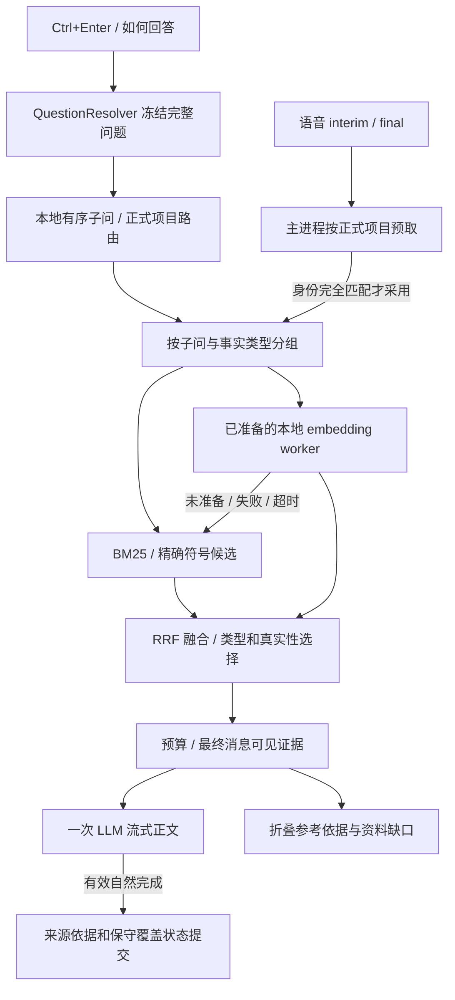

# 面试助手与项目检索

Cue 在原有 ASR、QuestionResolver、ConversationMemory 和项目路由之上增加资料类型、逐子问证据选择与异步本地语义检索。Electron 启动链仍是 `package.json → src/custom-main.js → src/bugfix-main.js → main.js`。默认回答只调用一次生成模型，不增加在线问题规划、HyDE、模型重排或二次核验。



## 按键与问题快照

`Ctrl+Enter` 随时响应，包括尚未结束的发言和当前没有可识别问题的情况，不等待在线规划模型。新的回答请求取消旧生成，epoch 和请求身份拒绝迟到结果。`Ctrl+Shift+Enter` 或“屏幕与问题”结合本次截图、当前要求与相关历史修改代码或回答问题。其他已有快捷键保持原有行为。

本地规划保留完整原问、场景、约束与有序子问。典型检索合并为 1–4 组，重复需求可以共享召回；超出上限的需求保留在原问中并报告缺失，不静默丢弃尾部问题或新项目名称。

## 项目与资料边界

可选 `interview/project.md` 清单提供稳定项目 ID、名称、别名与简历序号。`resume_order` 决定序号，导入先后不决定它。没有清单的旧项目仍可使用。界面“当前项目”默认自动，手动选择只提供默认上下文，显式项目名称或切换仍优先。通用原理题暂停项目事实，明确回到项目后恢复。项目比较按子问绑定项目，来源保留项目标签。

会话历史用于指代，助手旧回答不能成为项目事实。清空会话保留只读导入快照和已准备模型，但清除讨论、问题缓存、预取与生成任务。重新导入、来源版本或模型变化会使相关旧结果失效。

导入示例见 [用户资料与项目导入](user-data-import.md)。新导入解析 Markdown 标题树、围栏、表格、父段与真实字符偏移。代码使用保守的词法解析与实际调用关系，不声称完整解析反射、动态调用、跨语言符号或所有重载。`code_refs` 与 `related_docs` 只恢复本项目中存在且可核验的片段，受跳数、邻居数与最终预算限制。旧 v1/v2 快照保持可读，重新导入才能获得新结构元数据。

## 召回、选择与缺失

检索先过滤 scopes，再按子问召回 BM25、精确路径/符号与可选真实 embedding 候选，使用 RRF 排名融合。128 维 feature-hash 是旧本地回退，不是学习式语义模型；真实 embedding 生效时不再把同词 hash 当作第三份等价证据重复加权。

选择器区分实现、决策、困难/事故、指标、职责/协作、部署环境与一般原理。代码不能替代个人贡献，相关词不能替代真实事故与测量记录。计划、假设、弃用方案和测试数据保留原有真实性范围，未知材料保持保守。`confirmed` 只表示用户确认，不是第三方证明。

原文进入明确的数据边界，检索前缀只用于索引。最终预算包括来源标签、固定规则、完整问题、约束、历史、讨论状态与输出余量。只有实际进入最终消息的来源才能提交为本轮依据；隐藏尾部与被裁掉的指标环境不算命中。界面“参考依据/资料缺口”显示项目、文件、节选与缺失项，口述正文不强制罗列路径。

## 本地语义检索与回退

本地模型为 `Xenova/multilingual-e5-small` 固定 ONNX 快照，384 维 mean pooling 与 L2 normalization，分别加 `query:` / `passage:` 前缀。模型在 worker 中运行，导入时建立向量，回答时只查询已准备模型和快照。准备、校验和与故障处理见 [本地语义检索](local-semantic-search.md)。

必须明确点击“准备本地语义检索”或选择已准备模型目录，`Ctrl+Enter` 和回答阶段不会下载模型。模型缺失、未 ready、快照不匹配、worker 异常或超时均继续使用基础检索并记录原因。语义最多等待约 100 ms，剩余请求预算更小时提前回退；迟到结果不修改已构造的当前提示词。

向量复用依据内容、项目版本、chunker/parser/schema、模型、tokenizer、dtype 与 pooling 身份，删除或改变的文件不能借用旧向量。问题结果缓存身份包含 epoch、scopes、项目 revision、模型版本、完整问题 hash、questionVersion/sourceKey 与检索配置，来源 key 相同也不能复用纠正前的提问。

## 输出与供应商

固定规则放在动态资料前。答案第一两句回应当前问题，多问按原顺序覆盖；历史建议不是事实，推演保持“如果/我会”。普通口述仍使用 400、640 或复杂题 1000–1800 Token 上限，截图解释和改代码保持独立预算。上限不是目标字数。

适配器保留字符串系统提示词、流式 token、取消、完成、截断与拒答信息。自然结束不能替代逐问正确性；只有有效请求完成且本地检查找到相应回答证据时才保守标记 covered。未知、取消、过期、空答或截断不误记为全答完。

思考开关、usage 与 prompt-cache 信息按具体供应商协议处理，不对所有 `qwen*` 注入同一未经支持的参数。固定前缀提高复用机会但不保证缓存命中。日志区分 estimated tokens 与实际 usage，不打印 API key、整份源码或个人故事。

## 验证命令与测量边界

```bash
npm test
npm run test:ui
npm run eval:rag -- --out /tmp/cue-rag-eval.json
npm run benchmark:rag -- --iterations 5 --out /tmp/cue-rag-latency.json
npm run eval:rag:semantic -- --model-dir /已准备且带校验清单的模型目录 --out /tmp/cue-rag-semantic.json
```

普通 CI 和默认评测不下载模型、不调用真实云 LLM。语义命令只校验并使用指定目录；准备失败会报告阻塞，不能把确定性候选通过当成 ONNX 成功。打包与平台检查见 [发布说明](packaging.md)。

评测数据位于 `test/fixtures/rag-evaluation/`：两个完全合成项目，各 30 问，其中 20 问为开发集、10 问为保留集，相同技术词对应不同实现、职责与指标。gold 与回放位于索引目录之外，问法不复制进 aliases。公开静态保留集不能替代未来独立盲测。

60 问比较同步兼容检索、逐子问 typed 检索与显式已准备的真实 semantic 检索。baseline 表示在相同新索引上运行旧同步兼容路径，不是另一个 Git 提交的完整程序。报告候选来源召回、最终消息可见关键事实覆盖、多问完整覆盖、跨项目泄漏和 missing 识别；找到文件不代表关键事实进入提示词。连续回放额外使用真实 package 启动链、快捷键、runFeature 与 LLM 适配器捕获最终 SDK messages，只有 OS/硬件和模型传输使用可控模拟。

基准分别记录导入/索引冷启动、首次准备、暖态、有/无精确预取与受控 worker 失效。`--cpu-contention` 可测试合成 CPU 竞争，不等同于真实 Whisper。设计目标为暖态检索 P95 ≤50 ms、本地按键到请求准备 P95 ≤150 ms，结果必须按当前机器实测报告。真实网络/模型/UI 首字、Whisper 竞争和用户材料回答质量需另外测量。

本轮实测与尚未验证项目见 [检索评测记录](rag-evaluation-report.md)。每次运行记录源码与 gold 哈希；源码在测量期间改变时应重跑。

可用 `--samples /人工审阅样本.json` 加载生成样本：`[{"caseId":"synthetic-tide-01","claims":[{"supported":true,"reviewNote":"与指定来源逐项核对"}]}]`。没有样本时，无依据事实比例显示未测量，不用检索分数冒充回答真实性。
