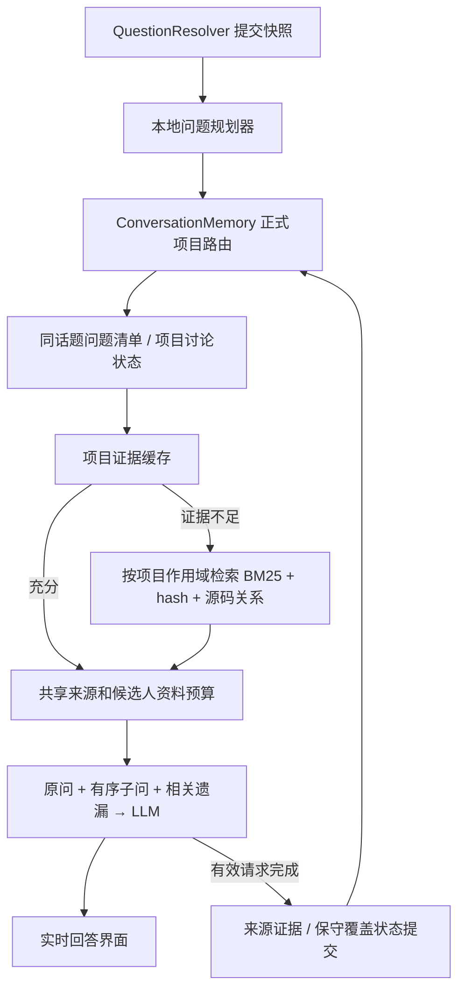

# 面试助手架构

Cue 保留现有 Electron 启动入口和 STT / QuestionResolver，在确定当前问题后增加本地问题规划、覆盖清单、项目讨论状态和项目证据缓存。没有新增运行依赖或规划模型调用。



## 问题与讨论状态

`planInterviewQuestion({text, partial, sourceKey, mode})` 保留原文及原文位置，识别中文、英文场景、约束和有序子问。解析不确定时保留原问；最多展开 32 个子问，`omittedQuestions` 报告超出部分，原文仍进入当前请求。可靠同源信息可以关联 partial 和完整 final；不靠相似文字合并不同发言。

`ConversationMemory.begin()` 返回 `interviewPlan`、`checklist`、`projectInterviewState`；既有 recent/archive、预算、activeProject 和项目切换隔离继续生效。清空会话会重置清单及讨论状态，并增加 epoch。

问题清单区分 `pending`、`covered`、`unknown`、`skipped`。覆盖指 Cue 建议的内容，不代表候选人实际说过。只有本轮有效请求成功提交、模型服务明确自然结束且本地规则找到相应回答证据，才标 covered。取消、拒答、截断、未知结束信息和部分发言不会被误记为全答完。判断保守，不是语义正确性的保证；不确定项保持 unknown。

新问优先，只有同话题仍适用的旧遗漏才补答。独立新题、显式项目切换与普通 Redis 八股题不会注入其他项目状态。“屏幕与问题”使用新截图和最新目标，不重发旧的未确认代码修改命令。

ProjectInterviewState 将有来源的 architecture/decisions 与 discussedTopics/unresolvedTopics/currentFocus 分开。助手旧回答、假设性扩容和推演方案不能升级为项目事实。导入索引或手工资料更新会使对应旧事实失效；候选人实际发言仍按既有自述来源记录。

## 项目证据与源码

ActiveProjectContextCache 只缓存有文件及行号的导入证据。按正式 scopes、索引 revision 和 schema version 隔离，默认最多 8 个缓存项，每项 24 条 / 18000 字符，20 分钟 TTL。

首次问题先限量预载 README、架构、核心代码与配置，再按项目作用域正式检索。后续问题需要的实体、主题、原因、故障处置或具体符号有充分证据时，跳过搜索；否则检索后回填。通用代码流程不能仅凭“缓存里有一个方法”判充分。检查也覆盖最终 提示词预算裁剪后的证据，隐藏的资料尾部不记入本轮使用证据。

本地索引仍使用 v2 容器，兼容 v1 读取；新导入使用 chunker / metadata schema 3。**升级后重新导入项目**，即可生成新的类、方法、调用和业务映射元数据。旧快照继续可以检索，缺少的结构字段不凭空补造。导入的是快照，修改原项目源码后也需要重新导入。

Java 的类头、接口声明、方法、imports、字段类型和实际 receiver calls 可用于定位 Controller → Service → Repository。中文业务词到符号的关联来自文档或源码注释。只有唯一、证据明确的关系才展开；重载、同名类、动态调用等标为未解析或歧义。框架继承的 Repository 仅引用仓库内声明，不声称仓库里存在框架 `save()` 的实现。

检索复用 BM25 和本地 128 维 feature-hash，每个召回通道最多 50 个候选，融合和本地排序后按模式选取 3–6 条证据（代码定位及复杂题通常 5 条）。作用域在候选、融合、缓存和关系展开各阶段都受约束。

## 可选检索接口

默认不启用神经 embedding、外部向量库或模型 reranker，也不发生额外网络调用。`ProjectSearch.build(chunks, options)` / `buildAsync` 保留旧调用兼容，可选以下同步接口：

```js
const options = {
  vectorProvider: {
    ready: true,
    modelVersion: 'local-model-v1',
    search({ query, scopes, limit, candidates }) {
      // candidates: [{ id, chunk }]，仅包含当前 scopes 的源码。
      // 返回实际候选源 ID 和 0..1 分数；此处接自有本地服务。
      return [];
    }
  },
  reranker: {
    ready: true,
    modelVersion: 'local-reranker-v1',
    rerank({ query, scopes, candidates }) {
      // candidates: [{ id, chunk, score, confidence }]
      return [];
    }
  }
};
```

外部返回的未知 ID 或其他项目证据会被忽略。服务的版本参与缓存身份。禁用、异常或异步接口退回本地检索；异步函数不在此同步路径调用。真正启用远程 embedding 需要另行接入明确的异步编排、模型版本与超时边界，当前接口不是远程服务实现。

## 提示词、完成信息与测试

项目深挖按当前问题需要组织结论、原因、实现、取舍与优化方向，避免反复介绍项目。简单概念题使用 400 Token 上限，普通单问 640，复杂题和多子问 1000–1800。“屏幕与问题”及带截图的手动提问按任务调整：简短解释 1200，复杂解释 2400–4096，改代码和未知截图题保留 4096。输出上限不是强制字数。

`llm.stream()` 仍返回字符串并通过 onToken 流式输出，增加可选 `onCompletion({finishReason, complete, truncated, refused})`。这些元数据描述 服务结束状态，不能代替逐问语义判断。

全量测试命令：`node --test test/*.test.js`。专项包括实际启动入口 → 启动补丁 → 主进程 → LLM 适配器发送的最终 SDK 请求、漏答与补答、项目切换、30 分钟回放、缓存失效及预算、源码三层调用证据、partial/abort/clear、各模型服务的完成状态。模型传输使用确定性模拟；真实模型回答质量与真实 TTFT 需要使用实际模型另行评测。
